<%
	meta("../../meta.json")
	meta()
	const path = require('path');
	url = url + "/posts/" + path.basename(path.dirname(outputPath)) + "/";
%>
<%= render("../../_partials/post-header.html", { title, image, url, description, caption, date }) %>

<h1 class="toc-header">Table of contents</h1>

%%toc%%

Last Friday I went to the toy store with my boy, and while he was rummaging through the Spider-Man section, my eyes caught sight of a section with very low-cost toy robots.

As I'm playing with agents, LLMs, speech-to-text, and text-to-speech, I thought: why not buy myself one of these low-cost robots, take it apart, and turn it into a fun little LLM-powered toy for my kid and possibly the other kids in the hood?

Or even better: turn it into a STEM learning project that the other parents in the hood and I can do with our kids. That means keeping the work super simple and only using materials that are readily available. There might be some soldering, but I can do that for everybody else.

I went ahead and bought a [Silverlit YCOO NEO OCTOBOT](https://robo.silverlit.com/products/octobot/) ([also on Amazon](https://www.amazon.de/dp/B0CV8S1WWX)) for 10 euros, which looks like this.

<figure>
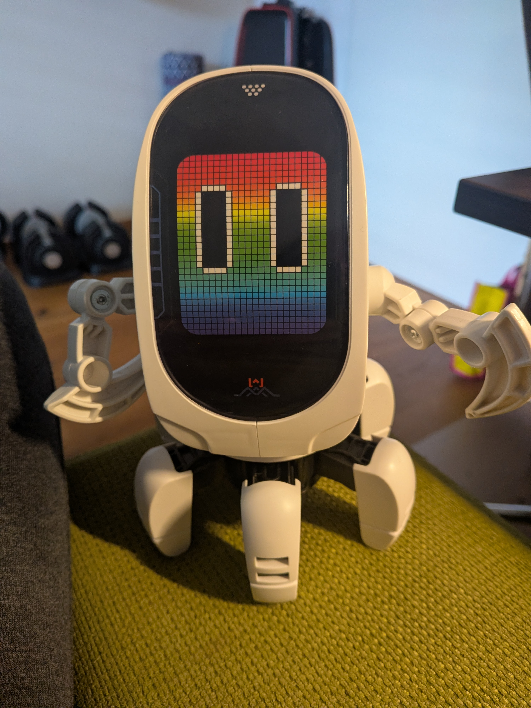
<figcaption>The box set. It has a full LED matrix.</figcaption>
</figure>

The little robot came with a remote that lets you turn its head counterclockwise or move it forward in the direction it's facing. There was also a little dance button that just randomly turned its head and moved it forward, and some other buttons I didn't even try. The arms are non-functional. You can pose them, but that's pretty much it. Also, that LED matrix is actually not an LED matrix, but more on that later.

First task, disassemble the thing and figure out how it works.

## Disassembly using violence

Being the craftsman I am, I naturally didn't have the watchmaker screwdrivers I needed to unscrew the eight-ish or so screws. So instead I used violence.

<figure>
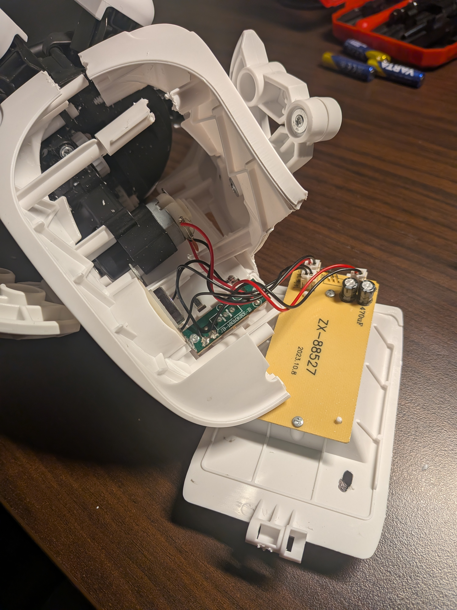
<figcaption></figcaption>
</figure>

As it turns out, the advertised LED matrix display was just a few RGB LEDs and a printed inlay on top of it. The inlay is a sort of translucent printed piece with a pixelated rainbow grid and two black eyes on it, with a clear plastic dome sitting in front. The LEDs just shine through it from behind.

<figure>
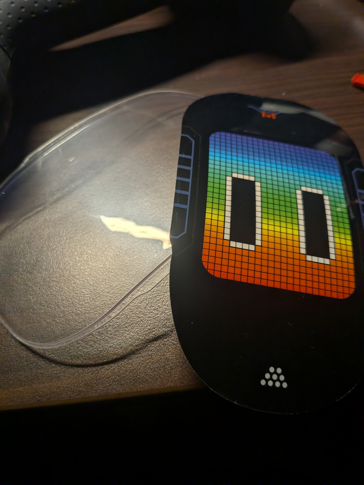
<figcaption></figcaption>
</figure>

With the display removed I had access to the PCB's front side, which showed me a rather trivial layout and set of ICs.

<figure>
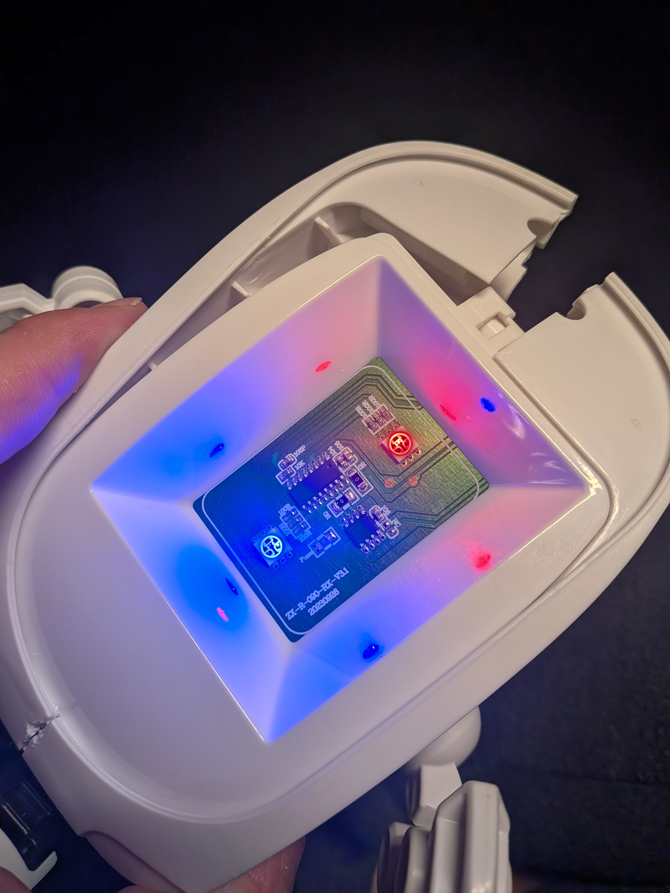
<figcaption></figcaption>
</figure>

I went ahead and ripped off the top of the robot, leaving me with just the legs, the motor driving them, and the battery bay sporting three triple A batteries. Then I started to trace out the PCB to understand it.

## Reverse engineering the PCB and mechanics

The PCB turned out to be really, really simple. I suppose Chinese electronics toys all have this quality to keep costs down. And some of the design was kinda impressive to me as a layman who doesn't have a lot of experience with electronics or mechanical design. Here's the PCB.

<figure>
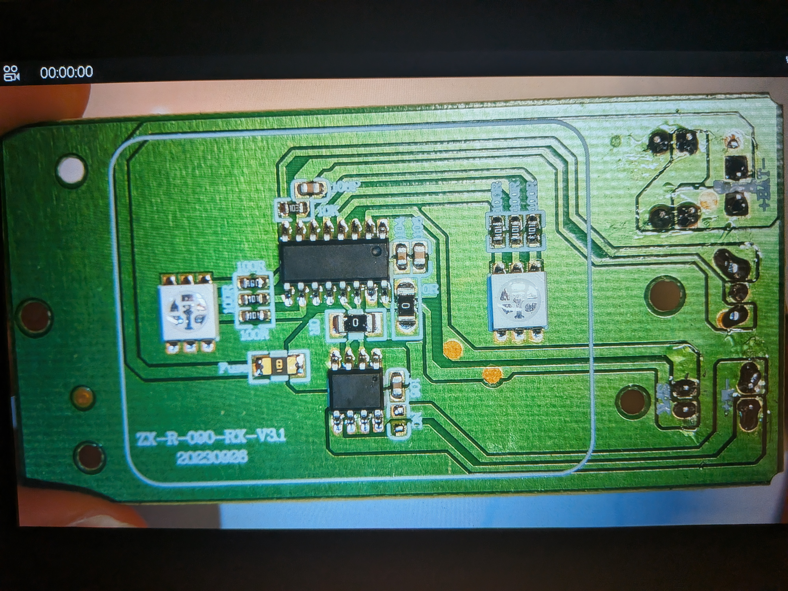
<figcaption></figcaption>
</figure>

In the top left you see the battery connector, which on the back is connected to two capacitors that just make sure the motor gets enough juice in case they stall or draw more power than expected.

The big IC in the middle is the brain. It handles communication with the IR receiver on the middle right, controls the LEDs on either side, and drives the H-bridge, which is the tiny black chip at the bottom.

Interestingly enough, the PCB is a single layer board. If you look closer, you can spot two zero ohm resistors used as little bridges over traces that would otherwise cross.

<figure>
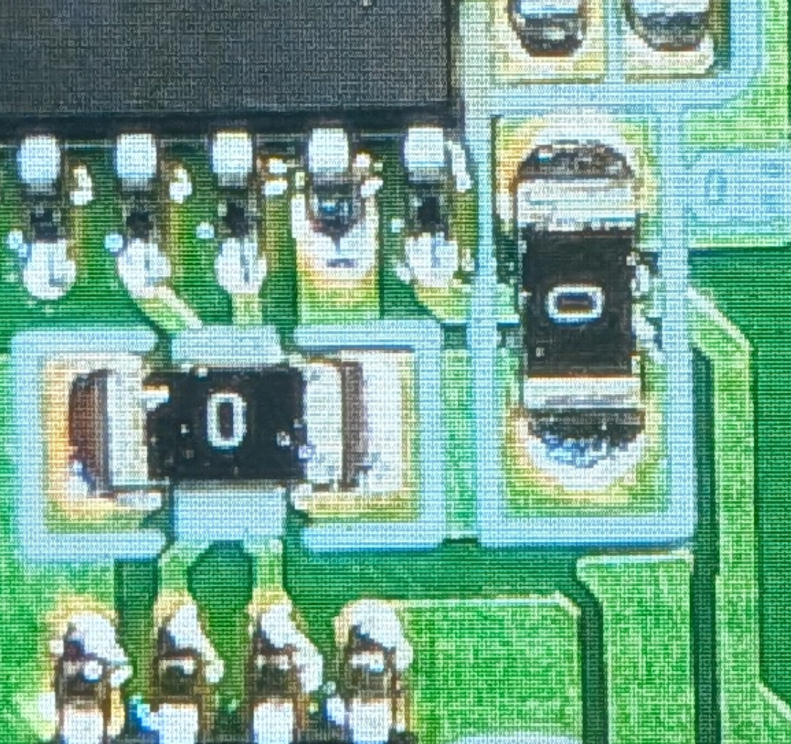
<figcaption></figcaption>
</figure>

For me this meant I could just remove the stupid brain IC, which I didn't need, and basically just hijack the H-bridge.

But there was one mystery left. There's only one motor in the robot, but the robot can either walk or turn its head. And the H-bridge only has two of its outputs connected to that motor. So how could the robot turn its head and move forward with just a single motor? Here's how.

<video src="media/mystery.mp4" controls loading="lazy">
</video>

The design is rather simple. There are two sets of gears, and depending on the direction the motor is turning, either one of them is engaged. In the back, a tiny gear rotates the top platform, which sets the walking direction via what I can only describe as a transmission. Then if you reverse the motor, the legs move in the direction set by that gear. I found this super genius.

Of course, this also means the robot can only walk forward and can only turn in one direction.

## Big plans

Now that I understood how the whole thing works, I started forming a plan. Since I had promised my boy we'd try it out the next morning, I had to move fast. And since I don't have my 3D printer at home, any chassis would have to be built from whatever I had around. That means cardboard.

The next decision was that I'm not going to use my trusty ESP32 boards or one of the dinky little displays I can drive with them, but instead just use my phone as the display and brain of the robot.

With that as a constraint, I had to think of how the phone could control the motor for the rotation and the legs. Luckily enough, I have an [Adafruit FT232H](https://www.adafruit.com/product/2264) at home.

<figure>
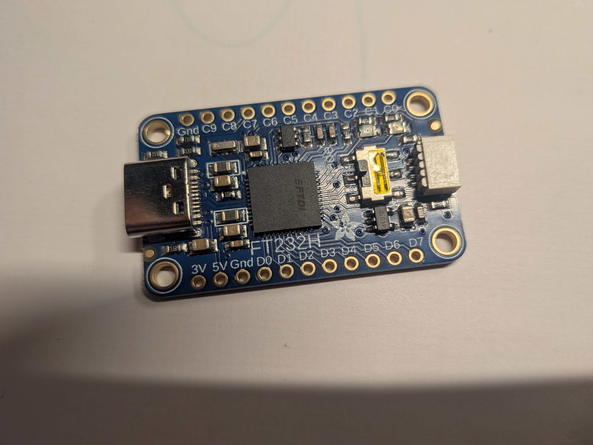
<figcaption></figcaption>
</figure>

The FT232H can be connected to a phone or computer and gives it kind of the same capabilities that you have on a Raspberry Pi, for example. Specifically, you can use some of its pins as GPIOs, meaning you can send signals into a circuit programmatically. This is exactly what we need to drive the motor driver on the robot's PCB.

That just leaves us with the software. I could have tried to cram everything into the phone with a native app, but having suffered through Android development in the 2010s, I really didn't want to do that.

Instead, I opted for a client-server architecture. The server runs on my laptop and is the actual brain of the robot. It manages speech-to-text, text-to-speech, the LLM, and the agent itself. The ultimate goal here is to have all the machine learning models run locally, so any interactions of my boy with the robot stay private.

The phone is then just a dumb renderer, exposing audio input and output to the server, as well as tools like taking a photo or driving the motor via USB.

Both the server and client side run on TypeScript. On the server I use Node, and the client is just a website served by the server. That in theory makes the client run anywhere there's a browser, except Safari on iOS, because that obviously doesn't implement WebUSB. Because Apple hates the web.

On the UX side, I wanted it to be a friendly, playful, non-sycophantic voice assistant my boy (and other kids in the hood) can talk to and have fun with. It doesn't take a lot to entertain young children, so I didn't want to add too many features. The kids should just be able to speak to it naturally: ask questions, request jokes or stories, have it search the internet, take a photo to read text out loud, play music on Spotify, and obviously walk and turn. I also want the robot to have simple memory, so it can remember past conversations.

I wanted the experience to be as seamless and intuitive as possible, so the speech-to-speech pipeline had to be as good as I can make it within the time constraints of one or two nights.

## Rewiring the electronics

This part sounds kinda scary to the uninitiated, but if you have used a soldering iron and a heat gun before, it's actually really easy.

First we need to decapitate the existing robot's PCB. That means getting rid of the big fat black mystery IC. For that I use my trusty heat gun with about 250 degrees Celsius.

<figure>
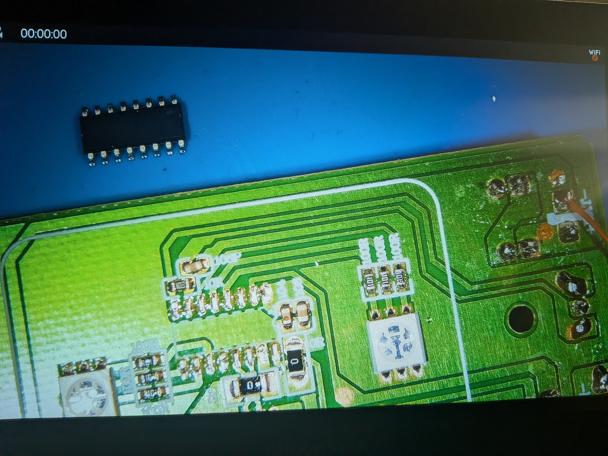
<figcaption></figcaption>
</figure>

It doesn't quite matter if the resistors and caps next to the chip go belly up as well during that process. You just need to make sure that nothing around the H-bridge at the bottom gets fucked up.

Next I soldered two 10cm pieces of wire-wrapping wire to the two top pins of the motor driver.

<figure>
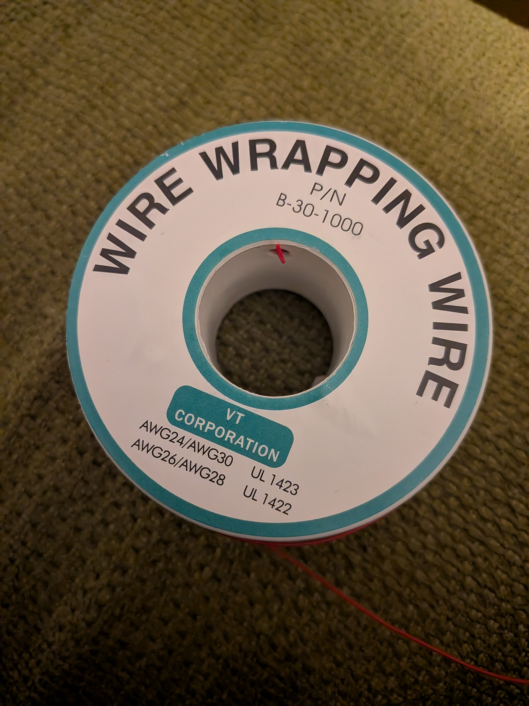
<figcaption></figcaption>
</figure>

<figure>
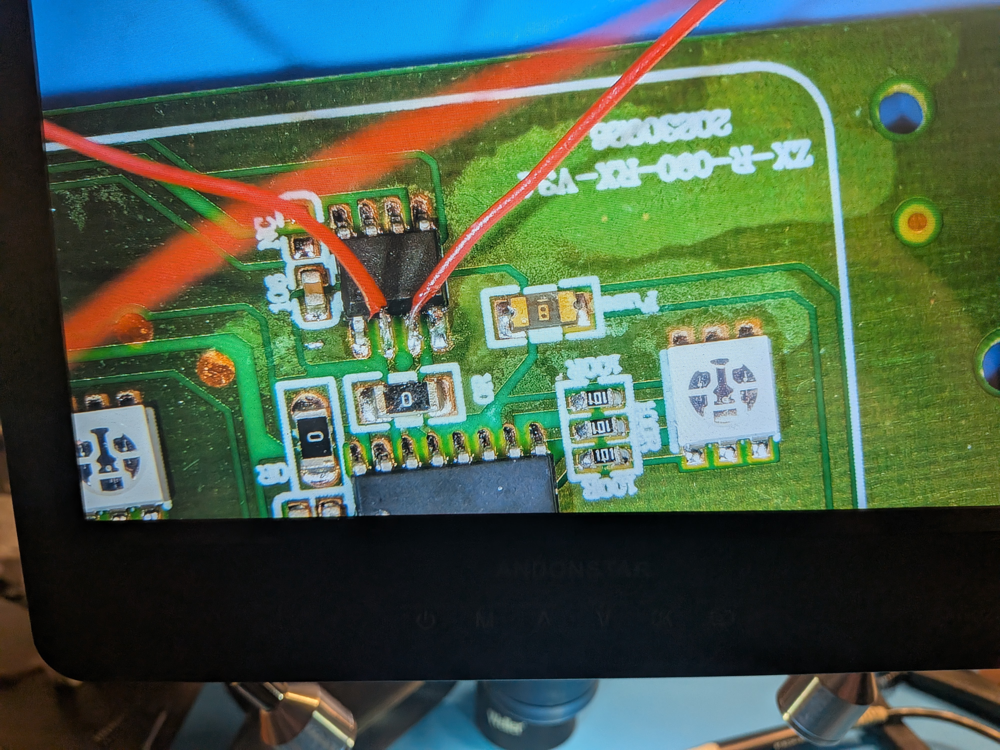
<figcaption></figcaption>
</figure>

This can be a little finicky. If you manage to bridge the pins, don't worry. You can use some solder wick, a piece of copper braid you put on top, to get rid of the excess solder. I use a standard soldering iron with leaded solder at 350 degrees Celsius. See my [Boxie blog post](/posts/2025-04-20-boxie/) on the exact gear I use.

Next I soldered those two wires to pins D4 and D5 on the FT232H board. We can then [bit-bang](https://en.wikipedia.org/wiki/Bit_banging) those pins via USB to drive the motor. And finally I soldered another piece of wire between the ground pin on the FT232H board and the ground pin on the robot's PCB for common ground. <figure>
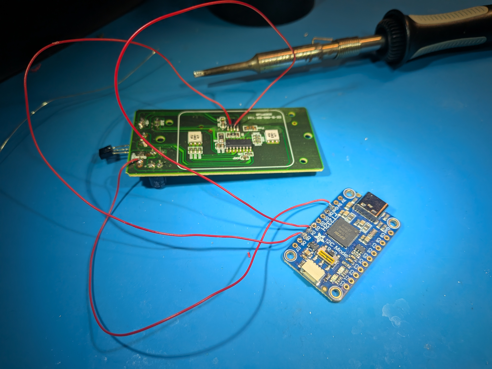
<figcaption>The mystery IC is still on in this picture. Just ignore it.</figcaption>
</figure>

And that's all the soldering you need to do. Once that was in place, I had my little coding agent write a single-page HTML file to test the full chain from WebUSB through the FT232H and H-bridge to the motor.

<video src="media/webusb.mp4" controls loading="lazy">
</video>

Great success. The wiring was correct and I could drive the motor from WebUSB.

Onwards to the chassis design.

## Cardboard engineering

Time to construct the new upper body from cardboard. The first thing I actually did was use double-sided tape to create a sandwich of the battery bay I retained from the original robot, the PCB of the original robot, and the FT232H. So I have a snug little package I can put in whatever chassis I have.

<figure>
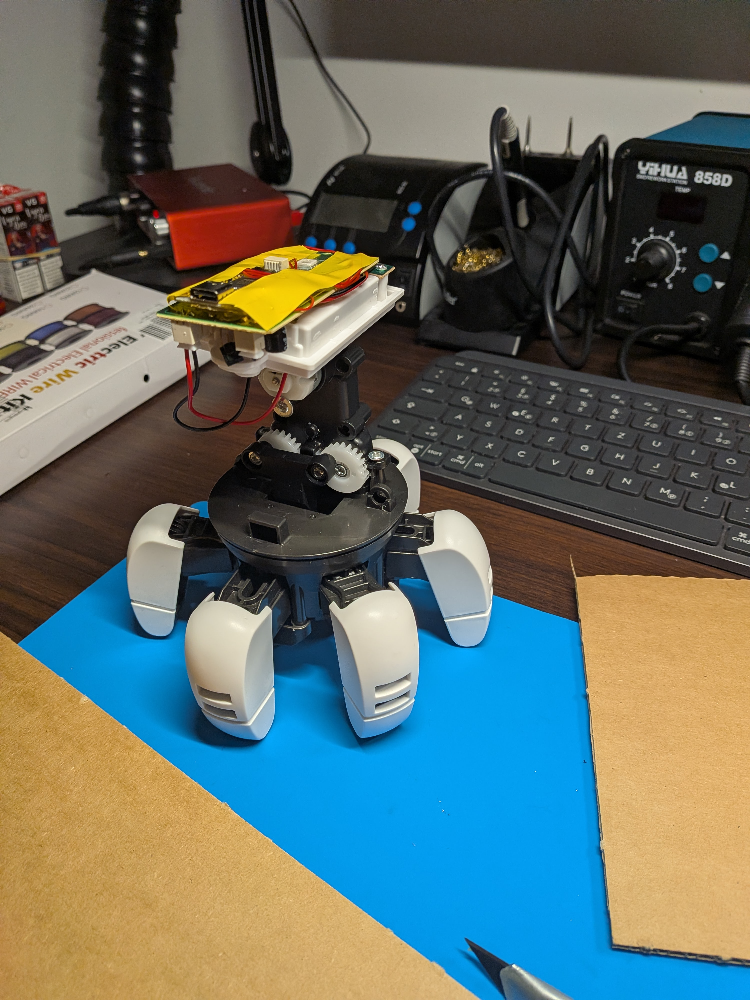
<figcaption></figcaption>
</figure>

I used some Kapton tape between the FT232H and the original PCB for isolation. You put it between boards to stop them shorting each other. I also used some tape to reel in the wires. But then I got stuck. The round base kinda didn't make sense to me as a chassis, and I couldn't figure out how to mount both the package and the phone on it.

<figure>
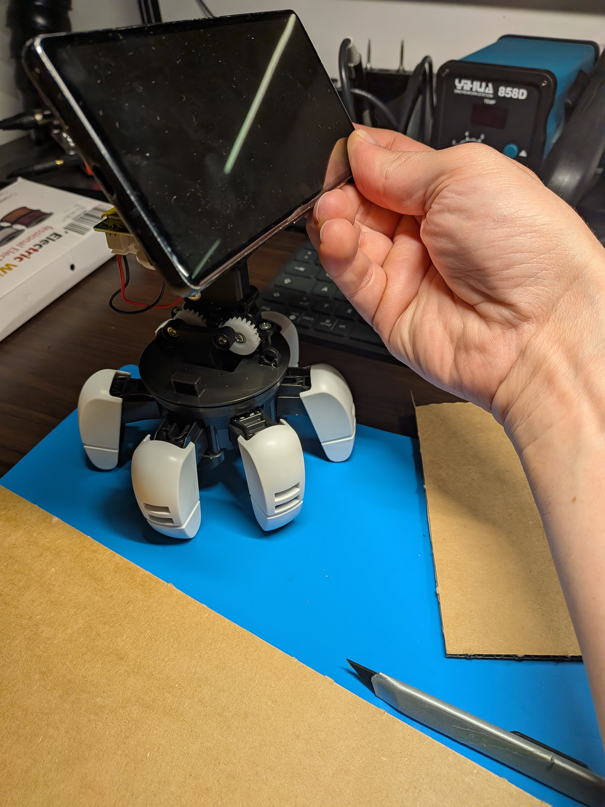
<figcaption></figcaption>
</figure>

That was until my wife burst in, looked at the thing for one second, and then did this.

<figure>
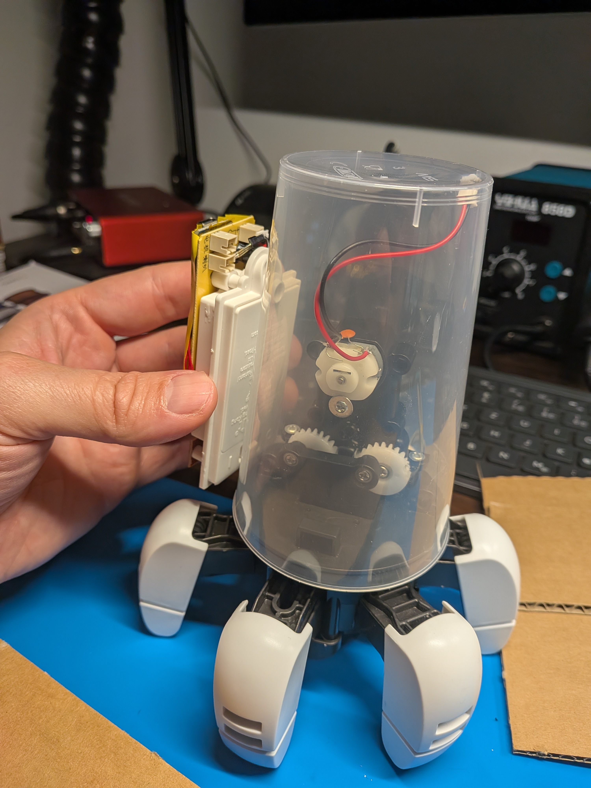
<figcaption></figcaption>
</figure>

I'm obviously married to a genius. It didn't occur to me that I could just put a cup on top of that. She then found a better fitting paper cup, slightly smaller, which I cut a hole into with a craft knife to fit the little package.

<figure>
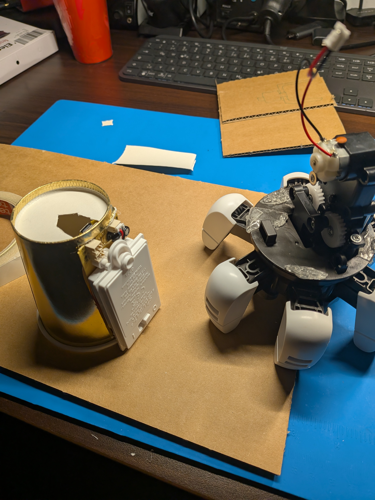
<figcaption></figcaption>
</figure>

I also did a little cutout at the top of the paper cup so the USB port was accessible and through which I could thread the cable from the motor to the original PCB. I then stuck some double-sided tape onto the base of the robot as well as on the lower rim of the paper cup to stick them together.

<figure>
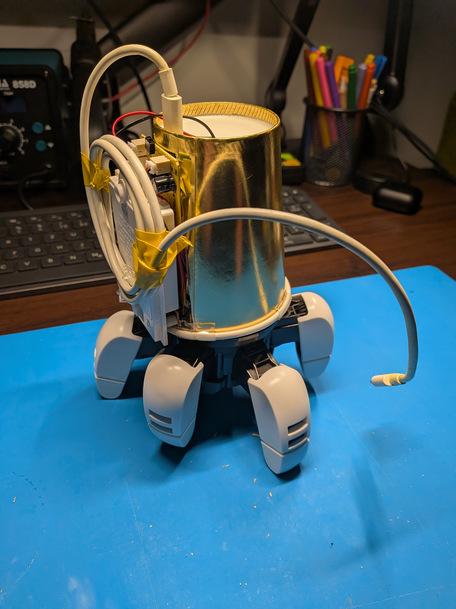
<figcaption></figcaption>
</figure>

For my final trick I just had to design the top of this abomination. Since the top rim of the paper cup was nicely horizontal, that was rather easy. I took some cardboard, made some measurements, and then cut to taste.

<figure>
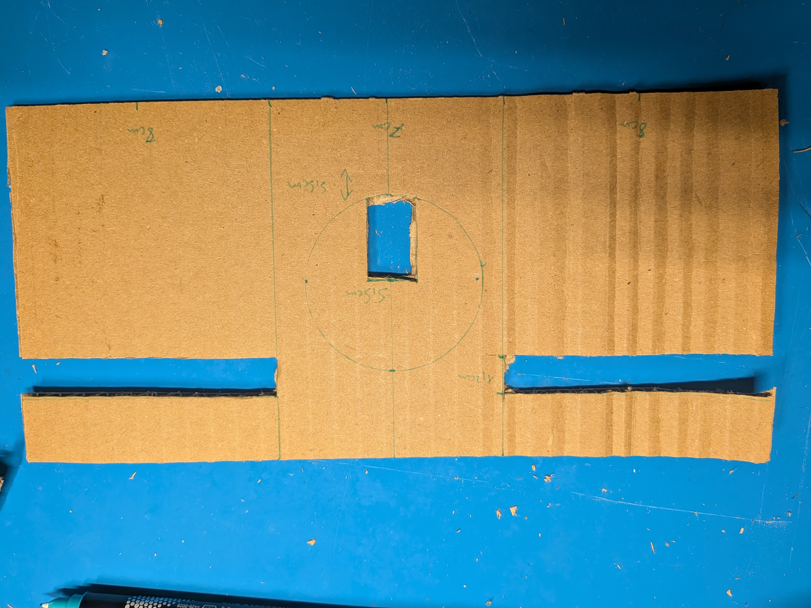
<figcaption></figcaption>
</figure>

<figure>
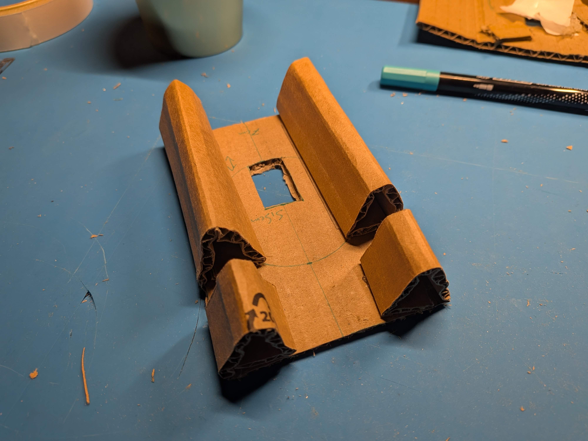
<figcaption></figcaption>
</figure>

You can probably derive how this fits together from the images. I used some double-sided tape to secure the fold-ins. Then I put some double-sided tape at the top rim of the paper cup and at the bottom of the top part so those stick together nicely as well. And one more tiny piece of double-sided tape at the front of the top part where the phone sits, so it gets a little stuck there and doesn't fall off. Here's the result.

<figure>
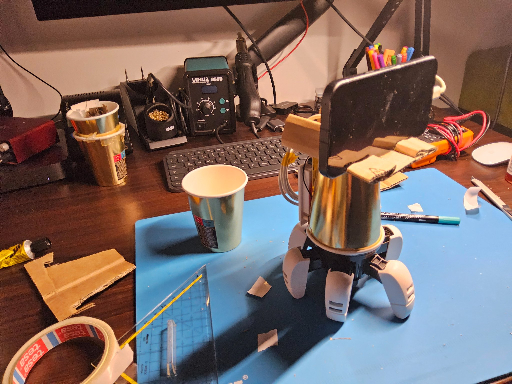
<figcaption></figcaption>
</figure>

<figure>
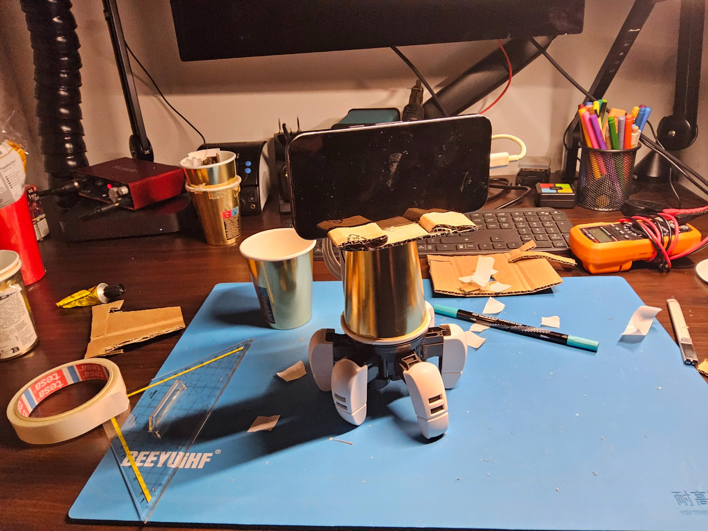
<figcaption></figcaption>
</figure>

I'm very happy with this construction. The only part that requires parental help is the craft knife work, but everything else is totally child friendly, including wiring things up. It's also super extensible. The kids can go wild, give it ears, arms, whatever they want.

It's also super easy to repair and super easy to switch out the batteries should they run out.

## The boring software

Now that the hardware was in place, I could start working on the software. As I said earlier, it's a client-server design. It's really fucking boring and I don't want to waste a lot of time on it, but here we go.

The general pipeline works like this. The phone continuously streams microphone audio to the server. The server runs voice activity detection to figure out when someone is actually speaking. Once speech is detected, it's transcribed in real time. When the utterance is complete, the transcript goes to the LLM agent, which generates a response and may call tools along the way. Some tools run on the server side, like web search or memory. Others run on the client side, like taking a photo, controlling the motors, or playing music on Spotify. The agent's response is converted to speech and streamed back to the phone. At any point the user can barge in, which cancels the current speech and any running tools, and starts listening again. You can find the server's main orchestration logic in [src/server/index.ts](https://github.com/badlogic/pibot/blob/main/src/server/index.ts).

There are obviously many small details in all of this, but I trust that you and your coding agent can figure that out based on the [source code](https://github.com/badlogic/pibot). Here I just want to detail the little journeys I had along the way, mostly involving models, inference engines, and how to get the speech-to-speech pipeline stable enough from a UX perspective.

The first thing I did was find good speech-to-text and text-to-speech models that could run on my M1 Max and serve at least one kid.

### Speech to text

For speech-to-text, I already had a lot of experience with Whisper but was never really happy with it. It's essentially a batch model, meaning you give it the full audio and it returns the full text. You can turn Whisper into a kind of fake real-time streaming model, but its performance isn't super great. So instead I tried out [Parakeet TDT 0.6B](https://huggingface.co/istupakov/parakeet-tdt-0.6b-v3-onnx), an int8 quantized ONNX model that runs at 50x real time on my M1 Max. Parakeet is also a batch model, but much faster than Whisper.

I'm using [parakeet-rs](https://github.com/altunenes/parakeet-rs), an ONNX runtime wrapper to run Parakeet. I wrapped it in a small single-user Rust worker the server communicates with over standard IO, streaming raw PCM audio in and getting JSON events out. The worker handles all the fiddly bits:

- Runs [Silero VAD](https://github.com/snakers4/silero-vad), a tiny neural net, on 32ms audio chunks to detect when someone is speaking
- Once speech is detected, starts buffering chunks into an utterance
- Every 250ms, runs Parakeet on the most recent 4000ms of the buffer and emits an interim transcript. This lets the server detect stop words while the user is still speaking, so it can interrupt the robot mid-sentence if needed (barge-in)
- Once 800ms of silence is detected, runs Parakeet on the full utterance and emits a final transcript

The worker is currently single-user, but turning it into a multi-user worker mostly just means keeping Silero VAD state and the utterance buffer per user. At 50x real time, it should be possible to serve a couple of kids with the same worker.

You might wonder why I didn't just go with the Python version of Parakeet. The answer is that I fucking hate Python. And I'm infinitely sad that the whole machine learning community has decided that Python is the thing we should build production software on. Running it through parakeet-rs and the ONNX runtime is still a bit of a pig, but it allows me to ship mostly self-contained workers somewhere else should the need arise, without having to deal with all the Python badness. uv notwithstanding.

You can just take that worker and use it in your own projects. Easy peasy lemon squeezy.

### Text to speech

Initially I got myself an ElevenLabs API key and played around with that. I never planned on using this as the final solution. It's super fucking costly, and I also don't want to send any data to them, even if it's just an LLM's answer to a kid.

I "designed" a little friendly robot voice on ElevenLabs and created a 30-second reference audio file for voice cloning. I then went on a hunt to find a nice open-weights text-to-speech model that can do voice cloning, run at acceptable speeds, and give me output quality that is somewhat close to ElevenLabs. Or at least not absolutely fucking terrible. This is pretty easy for English. For German it's a little bit more complicated. Most text-to-speech models seem to focus on English and CJK.

I played with a bunch of options. [Pocketflow TTS](https://kyutai.org/blog/2026-01-13-pocket-tts) is great from a performance perspective, but for German it doesn't quite work. I also tried [OmniVoice](https://github.com/k2-fsa/OmniVoice), which is supposed to be the new king in town, but that too didn't sound anything like German. I tried a bunch of other things but nothing really worked well. Eventually I ended up with [Qwen3 TTS](https://github.com/QwenLM/Qwen3-TTS), and it's great. Except it's quite a big model comparatively and takes a lot of compute.

The Python MLX implementation of Qwen3 TTS, when using the [6-bit quantized 1.7B base model](https://huggingface.co/mlx-community/Qwen3-TTS-12Hz-1.7B-Base-6bit), runs at around 4x real time on an M5 Max and 2x real time on my M1 Max. That's acceptable for a single user, but as with speech-to-text, I really didn't want a Python dependency.

I ended up with [second-state/qwen3_tts_rs](https://github.com/second-state/qwen3_tts_rs), a Rust implementation of Qwen3 TTS based on MLX-C and Rust. It didn't directly work with the MLX model format though, so I started by fixing that. I then found out that the well-performing Python version achieves its performance by using a 6-bit quantized version of Qwen3 TTS, and that the Rust version had a bunch of bugs that were deal-breakers.

Naturally I vendored the source tree and used my trusty pi with GPT-5.5 to implement feature parity with the Python version. Along the way I found a mysterious bug in the MLX Metal kernels compiled with the latest Xcode. Long story short, I patched it, and now I have a [Rust MLX-C based Qwen3 TTS inference engine](https://github.com/badlogic/qwen3_tts_rs) that gives me the same performance as the Python version without all the Python gunk.

Ideally I would like a cross-platform solution, so that makes me a little sad. But there's only so much time to work on this.

The TTS worker is the inverse of the STT worker. As the LLM streams its response, the server accumulates tokens through a sentence chunker and pushes complete sentences to the worker one at a time via stdin. The worker streams raw PCM audio chunks back out via stdout, both using a simple binary framing protocol. This lets the server start playing audio back to the phone before the full response has been synthesized.

### Getting the speech pipeline right

Getting the speech-to-speech pipeline to feel smooth was the trickiest part. A few things worth calling out.

For low-latency responses, the server starts streaming text to the TTS worker as soon as the LLM generates its first complete sentence, using a simple regex-based sentence chunker. It then feeds one sentence at a time, so audio starts playing back on the phone well before the LLM has finished generating the full response.

For barge-in, I first tried WebRTC echo cancellation. The theory is that if we output model speech while someone talks into the mic, the cancellation will remove the model speech, leaving us with just the mic input. But the resulting audio wasn't good enough for STT. So instead, the client runs a [custom barge-in detector](https://github.com/badlogic/pibot/blob/main/src/client/barge-in.ts) alongside it. It keeps a ring buffer of playback audio as a reference, and for each mic frame correlates the mic signal against that reference at delays of 20 to 420ms to estimate how much of the mic energy is just speaker bleed.

If the mic RMS is above a threshold AND the unexplained residual is above a threshold, meaning the user is actually speaking and not just picking up the robot, it fires barge-in after 5 consecutive triggered frames. At that point it stops streaming audio to the server and flushes buffered preroll so the server can pick up the utterance from the start. The server then handles stop-word detection via interim transcripts and cancels TTS and any running tools.

### LLM and agent

In my quest to run everything locally, I started to get up to speed with the latest local LLM news. Given my M1 Max only has 64 gigabytes of unified RAM, I was looking for a smaller mixture of experts model. I ended up testing [Qwen3.6 35B A3B Q5_K_M](https://huggingface.co/unsloth/Qwen3.6-35B-A3B-GGUF) and [Gemma 4 26B A4B Q4_K_M](https://huggingface.co/ggml-org/gemma-4-26B-A4B-it-GGUF). These are both pretty capable tool callers for their size. They're also multi-modal, which means the kids can show them stuff.

I picked llama.cpp as the inference engine, which worked brilliantly out of the box. I also found that it can easily serve up to four children on my M1 Max with a sizable context window, and quite a bit more on my M5 Max with 128 gigabytes. So that's great.

By default, Pipi uses the Gemma model, just because I found it to be a little nicer from a personality standpoint.

The agent harness is obviously based on pi. I'm using the [new abstraction I'm working on](https://github.com/badlogic/pibot/blob/main/src/server/harness.ts) as part of the big refactor.

## How it started, how it's going

The day after we bought the toy, the boy was super excited. Sadly, I wasn't quite done. I had cobbled together the hardware and a first iteration of the software, but it wasn't ready yet. So instead of showing him the full robot that morning, I just showed him the software running on my laptop. This was still using ElevenLabs for text-to-speech and Claude Haiku as the LLM, and didn't have the full speech-to-speech pipeline yet.

<video src="media/test.mp4" controls loading="lazy">
</video>

But the test was a great success. The boy loved the interaction with the machine and basically showed it all his toys. We also played a little quiz where the boy would have to guess animals based on descriptions, which proved to me it was worth working on this.

After another night of working on integrating the software with the hardware, we took the little robot outside into the hood for its first field test. Six kids gathered around it and went kinda nuts. The outdoor environment proved kinda hard to handle at that point. Multiple kids speaking across each other isn't something the system can really handle well. They eventually figured out they have to take turns and find a quieter environment. The stupid parents kept babbling too. So they took the little robot into a hut and had it tell stories, jokes, move around, tell the kids what it sees, and so on. It was great fun observing that.

The following nights I kept working on the speech-to-speech pipeline, making it more robust. Here is the final version, or at least what I think is the final version of the bot.

<video src="media/demo.mp4" controls loading="lazy">
</video>

Here's how much RAM this uses on the server.

<figure>

<figcaption></figcaption>
</figure>

Still a few minor bugs to fix. The initial codebase was 100% vibe coded. I spent another night refactoring it by hand and with the help of my coding agent, so it's a little easier to extend in the future. I've also added support for Spotify, so the little bot can search, play, and control music or audiobooks for the kids.

A bunch of the kids actually came up to me and asked how to build a robot, so now we have six of those little fuckers.

<figure>
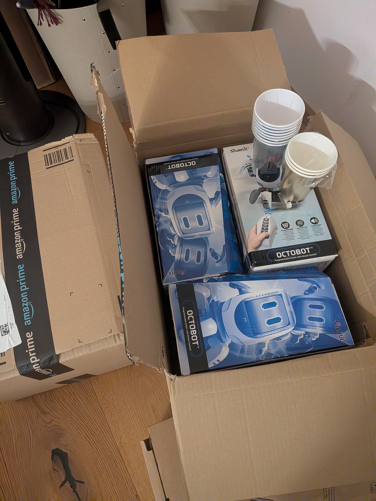
<figcaption></figcaption>
</figure>

The next time it's a rainy day we already agreed that we will all gather in our flat together with their parents and each build a robot. It's glorious.

The past months have been mentally exhausting. I'm kind of sick of the entire AI landscape. It all feels pointless. This little project has given me back a bit of my spark. We can still build stuff that delights humans, young and old and in between, using this technology for something worthwhile.

<%= render("../../_partials/post-footer.html", { title, url }) %>
